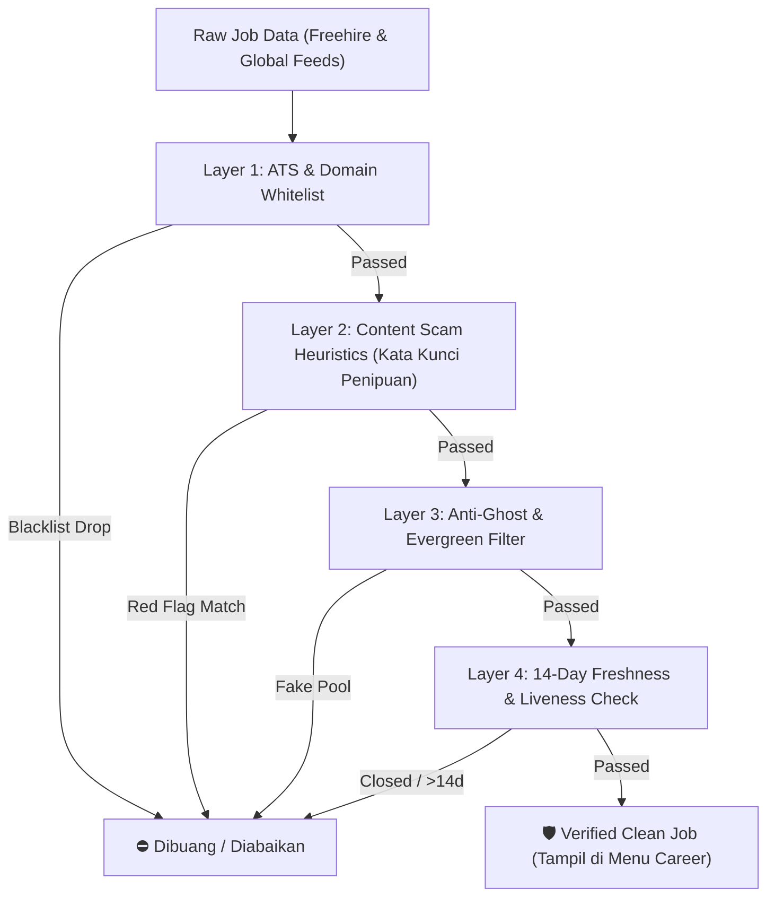

# Product Requirement Document (PRD): Global Career Portal & Anti-Scam Engine

> **Dokumen Spesifikasi Produk & Arsitektur Fitur Menu Career**  
> **Target Proyek:** CV & Engineering Portfolio Agus Maulana Yusuf Noor (`cv-agusmyn`)  
> **Riset Grounding:** [`strelov1/freehire`](https://github.com/strelov1/freehire) & [`career-ops-hq/career-ops`](https://github.com/career-ops-hq/career-ops)  
> **Status:** Approved Specification / Ready for Implementation  
> **Tanggal:** 18 November 2026  

---

## 1. Executive Summary & Latar Belakang

Menu navigasi baru bernama **"Career"** di dalam website CV/Portfolio ini berfungsi sebagai **Autonomous Job Radar & Verified Application Hub** personal untuk Agus Maulana Yusuf Noor.

Menu ini dirancang dengan 3 pilar utama:
1. **Cakupan Global (Worldwide):** Mendukung pencarian lowongan dari seluruh belahan dunia (Remote Global, Amerika Utara, Eropa, Asia Pasifik, Asia Tenggara, dan Indonesia).
2. **Freshness & Liveness Terjamin:** Hanya menampilkan lowongan yang terbit dalam **14 hari terakhir** (`posted_at <= 14 days`) dan **berstatus aktif/belum ditutup** (`closed_at === null` & lulus *liveness check*).
3. **Anti-Scam & Trust Verification Engine:** Dilengkapi sistem penyaring otomatis 4 lapis yang membersihkan link dari penipuan, phishing, Google Form palsu, rekruter abal-abal (Telegram/WhatsApp scams), serta *ghost jobs* (lowongan pajangan). Hasil yang tampil **100% link resmi dan terpercaya**.
4. **Relevansi CV Otomatis:** Menghitung skor kecocokan (*match score*) terhadap keahlian Agus Maulana (IT Department Head, Full-Stack, Backend, Linux SysAdmin, DBA, Golang, Python, Laravel, TypeScript).

---

## 2. Studi Riset: Analisis 2 Repositori Referensi

### A. `strelov1/freehire` — Mesin Agregator & Anti-Ghost Job
* **Repositori:** [strelov1/freehire](https://github.com/strelov1/freehire) (3.5k+ Stars)
* **Kelebihan yang Diadopsi:**
  1. **Public REST API v1 (`https://freehire.me/api/v1/jobs/search`):** Menyediakan feed JSON live lowongan kerja global langsung dari halaman karir perusahaan (bukan agen repost/spam).
  2. **14-Day Freshness Window (`internal/job/jobreality/classify.go`):** Mematok konstanta baku `freshWindowDays = 14`. Lowongan lebih dari 14 hari diklasifikasikan sebagai *stale* dan disaring keluar.
  3. **Evergreen Dictionary (`internal/job/jobreality/dictionary.go`):** Mendeteksi dan membuang lowongan palsu penampung CV (*talent pool* / *perpetual ghost listings*) yang memuat frasa *"always hiring"*, *"talent community"*, *"future openings"*, atau *"ongoing recruitment"*.

---

### B. `career-ops-hq/career-ops` — Mesin Trust Validation & ATS Liveness
* **Repositori:** [career-ops-hq/career-ops](https://github.com/career-ops-hq/career-ops) (83k+ Stars)
* **Kelebihan yang Diadopsi:**
  1. **Trust Validator Engine (`providers/_trust-validator.mjs`):**
     - Mengelompokkan domain menjadi **ATS Allowlist Terverifikasi** vs **Blacklist Domain Mencurigakan**.
     - Mendeteksi penipuan tautan, pemendek URL, dan formulir aplikasi tidak resmi.
  2. **Zero-Token Liveness Verification (`liveness-api.mjs`):**
     - Memverifikasi apakah lowongan di portal ATS (Greenhouse, Lever, Ashby, Workday, dll.) masih aktif dengan mengecek langsung endpoint API publik ATS (HTTP 200 = *Live*; HTTP 404/410 = *Closed*).
  3. **Job Match Scoring (`modes/oferta.md`):**
     - Memberikan skor 0–100% berdasarkan kesesuaian keahlian (*skill overlap*) dan bobot peran (*seniority & tech tier*).

---

## 3. Arsitektur Anti-Scam & Trust Verification (Penyaring Penipuan)

Untuk memastikan bahwa semua lowongan yang tampil di menu Career **100% aman, asli, dan bersih dari scam**, sistem menerapkan **4 Lapisan Verifikasi Keamanan**:

### Lapisan 1: Domain & Host Reputation (ATS Allowlist vs Blacklist)
1. **Verified Enterprise ATS Whitelist (Skor Kepercayaan 100%):**
   Lowongan diprioritaskan dan dijamin keasliannya jika mengarah langsung ke domain ATS resmi perusahaan ternama:
   * `greenhouse.io` / `boards.greenhouse.io`
   * `lever.co` / `jobs.lever.co`
   * `ashbyhq.com` / `jobs.ashbyhq.com`
   * `myworkdayjobs.com` / `workday.com`
   * `smartrecruiters.com`
   * `bamboohr.com`
   * `workable.com`
   * `recruitee.com`
   * `jobvite.com`
   * `icims.com`
   * `taleo.net`
   * `breezy.hr`
   * `join.com`
   * Portal domain korporat resmi yang terdaftar (misal: `careers.google.com`, `amazon.jobs`, dll.).

2. **Suspicious Link & Phishing Blacklist (Langsung Ditolak):**
   Setiap lowongan yang menggunakan salah satu dari tautan berikut **langsung dibuang**:
   * **Pemendek URL (URL Shorteners):** `bit.ly`, `tinyurl.com`, `t.co`, `cutt.ly`, `rebrand.ly`, `shorturl.at`.
   * **Formulir Pihak Ketiga Tidak Resmi:** `forms.gle`, `docs.google.com/forms`, Google Docs/Sheets publik, Typeform/Notion tanpa domain resmi.
   * **Direct Messaging Recruitment Scam:** Tautan yang memaksa pelamar mengontak Telegram (`t.me/*`), WhatsApp langsung (`wa.me/*`), atau akun personal tanpa sistem registrasi pelamar resmi.
   * **Domain Mencurigakan / Free Hosting:** Domain dengan ekstensi gratis/murah (`.xyz`, `.top`, `.tk`, `.buzz`, `.ml`) atau subdomain hosting gratis yang meniru (*spoofing*) nama perusahaan terkenal.

---

### Lapisan 2: Content Scam & Red Flag Heuristics (Penyaring Teks Penipuan)
Sistem memindai deskripsi lowongan menggunakan pola ekspresi reguler (*regex*) untuk mendeteksi modus penipuan umum:
* **Modus Biaya di Awal (*Fee / Equipment Scams*):**
  * Frasa: *"pay for training"*, *"equipment purchase fee"*, *"registration fee"*, *"wire transfer"*, *"crypto deposit"*, *"buy hardware through our vendor"*, *"check cashing"*.
* **Modus Phishing & Identitas Pribadi Berisiko:**
  * Frasa: *"interview strictly on Telegram @..."*, *"contact hiring manager on Signal/Telegram"*, *"send ID/SSN/KTP copy via email first"*.
* **Modus Gaji Tidak Masuk Akal (*Unrealistic High Pay for No Skills*):**
  * Frasa: *"earn $500/day copy pasting"*, *"no skills needed make $5000/week from home"*.
* *Aturan: Jika salah satu indikator ditemukan, data otomatis dieliminasi.*

---

### Lapisan 3: Anti-Ghost & Evergreen Filter (Berdasarkan `freehire`)
Menyingkirkan lowongan pajangan yang tidak memiliki kuota posisi nyata menggunakan kamus frasa terkurasi:
* *"we are always hiring"*, *"talent community"*, *"talent pool"*, *"future opportunities"*, *"open application"*, *"ongoing recruitment"*.
* *Hasil: Hanya lowongan dengan kebutuhan spesifik dan tenggat waktu aktif yang diizinkan lewat.*

---

### Lapisan 4: Freshness (<= 14 Hari) & Liveness Verification (Berdasarkan `career-ops`)
* **Freshness Gate:** Memastikan `ageInDays <= 14`.
* **Liveness Gate:**
  * Untuk link berbasis API ATS (Greenhouse/Lever), service mengecek endpoint JSON untuk memastikan status HTTP 200 (bukan 404/410).
  * Menjamin parameter `closed_at === null`.

---

## 4. Cakupan Wilayah Global (Worldwide Coverage)

Menu Career mendukung filter wilayah yang fleksibel:
1. **🌐 Worldwide / Global Remote (Default):**
   * Menampilkan lowongan kerja jarak jauh (*remote*) dari seluruh dunia tanpa batasan kewarganegaraan / *anywhere in the world*.
2. **🇮🇩 Southeast Asia & Indonesia (Remote / Local):**
   * Fokus pada lowongan di Indonesia, Singapura, Malaysia, Thailand, Vietnam.
3. **🇺🇸 North America / US (Remote):**
   * Lowongan teknologi dari perusahaan Amerika Serikat & Kanada yang membuka jalur *global remote* atau *contractor*.
4. **🇪🇺 Europe & UK (Remote):**
   * Lowongan teknologi dari perusahaan Eropa & Inggris.
5. **🌏 Asia-Pacific (APAC):**
   * Australia, Jepang, Korea Selatan, dan wilayah APAC.

---

## 5. Spesifikasi Teknis Antarmuka (UI/UX)

Tampilan menu Career mengikuti desain elegan yang sudah aktif di CV:
* **Palet Warna:** `#202734` (Midnight Dark), `#36415A` (Slate Blue), `#B7D894` (Sage Mint), `#E0F8C7` (Pale Mint).
* **Navigasi Atas:** Menambahkan tautan **`Career`** (Mode EN) / **`Peluang Karir`** (Mode ID).

### Kartu Lowongan Karir (*Verified Career Card*):
Setiap kartu menampilkan informasi terverifikasi:
1. **Badge Keamanan Terverifikasi (Trust Badge):**
   * `🛡️ Verified ATS` (Greenhouse, Lever, Ashby, Workday, dll.)
   * `🔒 Anti-Scam Passed` (Lolos verifikasi integritas domain & anti-phishing)
2. **Badge Kesesuaian Profil (*Match Score*):**
   * `🟢 95% Match` (Sangat Relevan dengan CV: Golang, Linux, Backend, IT Lead)
3. **Badge Waktu Terbit (*Freshness Badge*):**
   * `⚡ 2 days ago` / `⚡ Baru 2 hari lalu`
4. **Informasi Utama:**
   * Judul Posisi (e.g. *Senior Golang Engineer*, *Engineering Manager / IT Head*, *Linux Infrastructure Specialist*)
   * Nama Perusahaan + Lokasi + Badge `Remote Worldwide`
   * Tag Keahlian yang Cocok (`Golang`, `PostgreSQL`, `Docker`, `Microservices`)
5. **Tombol Aksi:**
   * **`Lamar Sekarang (Apply Now) ↗`**: Langsung membuka halaman aplikasi resmi perusahaan.
   * **`Salin Ringkasan Profil 📋`**: Menyalin ringkasan keahlian yang disesuaikan untuk lowongan tersebut.

---

## 6. Struktur File & Modul Teknis

1. **`src/services/anti-scam.ts`**:
   - Engine validator reputasi domain (ATS Allowlist, blacklist pemendek link, blacklist free-subdomain).
   - Regex scanner kata kunci penipuan (*financial scam, Telegram recruitment, fake fee*).
   - Filter evergreen ghost job.
2. **`src/services/career.ts`**:
   - Ingestion service dari Freehire API (`https://freehire.me/api/v1/jobs/search`) dan remote job feeds global.
   - Filter 14 hari terakhir.
   - Panggilan ke `anti-scam.ts` untuk membersihkan data.
   - Kalkulator kecocokan dengan profil `src/data/cv.ts`.
   - In-memory cache Bun (TTL 30 menit).
3. **`src/components/CareerPage.tsx`**:
   - Komponen halaman Career lengkap dengan filter wilayah (Worldwide, APAC, Europe, US, Indonesia), filter keahlian, dan daftar kartu lowongan yang bersih dari scam.
4. **`src/index.tsx`**:
   - Menambahkan rute halaman `app.get('/career', ...)` dan endpoint API `app.get('/api/career/jobs', ...)`.
